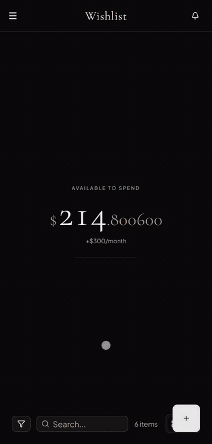
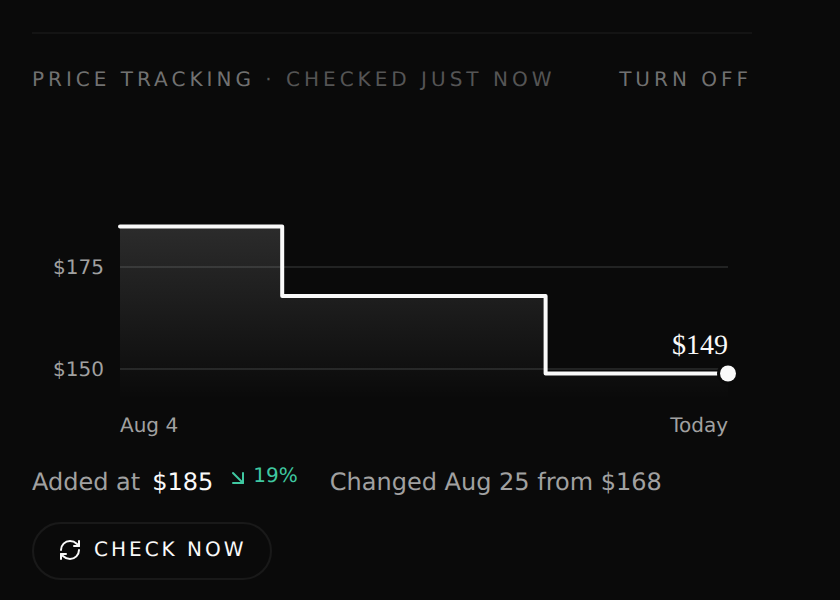
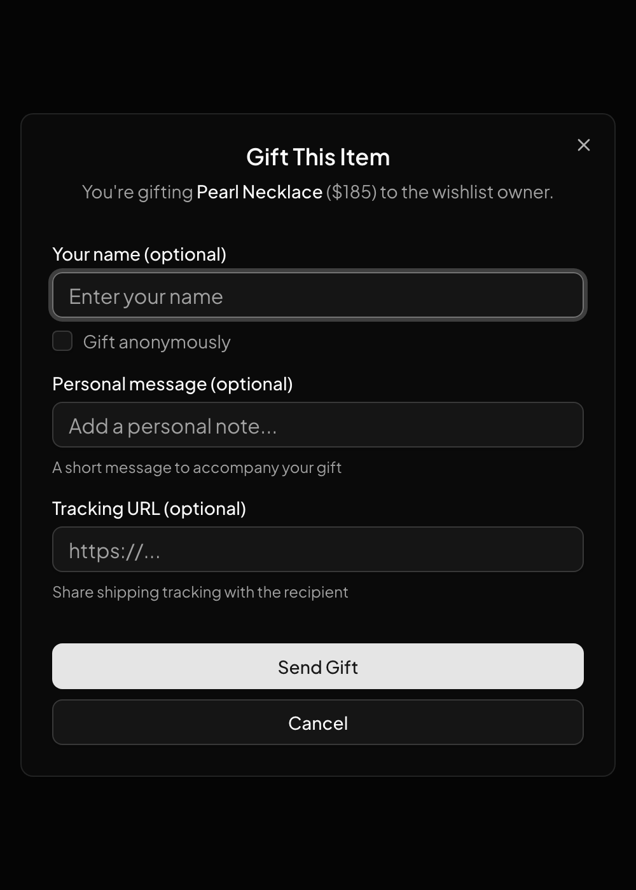

**Tapping "buy" online doesn't feel like spending money.**
Wishlist makes you wait: your allowance grows by the second, and nothing is ready to buy until it has cooled off.

<p align="center">
  
</p>

```bash
docker compose -f oci://ghcr.io/armanckeser/wishlist-stack:latest up -d
```

Then open `http://<server>:8080` and sign up. One container and settings: [deployment.md](deployment.md).

<details>
<summary>Install from your server's app store</summary>

**From your server's app store:** add the catalog once, then install Wishlist like any other app.

| Server | Where | Paste |
| --- | --- | --- |
| Cosmos | Market → Sources → Add Source | `https://armanckeser.github.io/selfhost-apps/servapps.json` |
| Umbrel | App Store → ⋯ → Community App Stores | `https://github.com/armanckeser/selfhost-apps` |
| CasaOS / ZimaOS | App Store → Add Source | `https://github.com/armanckeser/selfhost-apps/archive/refs/heads/casaos.zip` |
| Runtipi | Settings → App Stores → Add App Store | `https://github.com/armanckeser/selfhost-apps` |
| Portainer | Settings → App Templates → URL | `https://armanckeser.github.io/selfhost-apps/portainer/templates.json` |

Unraid's Community Apps doesn't list it yet; [selfhost-apps](https://github.com/armanckeser/selfhost-apps#add-the-catalog-to-your-server) has the template to add by hand.

</details>

<table>
  <tr>
    <td width="50%"></td>
    <td width="50%"></td>
  </tr>
  <tr>
    <td><sub><b>Price drops.</b> Every saved item is checked daily, and a drop sends a notification.</sub></td>
    <td><sub><b>Gifts.</b> Friends open your list and gift an item, anonymously if they like.</sub></td>
  </tr>
</table>

- **See your money grow.** The balance ticks up live; purchases come straight off the top.
- **Wait before you buy.** Set a rule like "3 days for every $100"; each item counts down.
- **Pay for impulse.** Buying before an item is ready freezes your balance for 7 days.
- **Paste a link.** Name, photo and price come from the URL, with daily price checks.
- **Share it for gifts.** Friends can gift an item from your list, and you get notified.

<details>
<summary>Why this exists</summary>

I built this for my wife. Research for one purchase meant a dozen open tabs, and tapping
"buy" online doesn't feel like spending money. A number that goes up and down makes
spending concrete again.

</details>

If Wishlist is useful to you, starring the repo helps other people find it, and [armanckeser.com/subscribe](https://armanckeser.com/subscribe) has ways to hear about new releases.

Developing: [development.md](development.md). Self-hosting: [deployment.md](deployment.md).

## License

Released under the GNU Affero General Public License v3.0 — see [LICENSE](LICENSE). If you run a modified version where other people can reach it, the AGPL asks you to publish your changes too.
